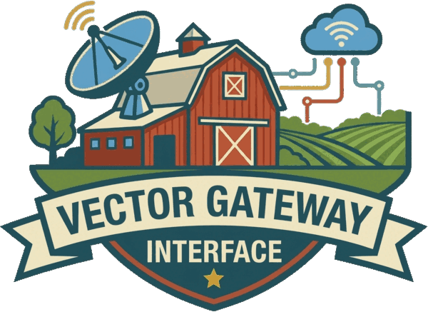

# Symbolic models through SQL

<a href="https://query.farm/"></a>

<a href="https://query.farm/vgi/"></a>

[Query.Farm](https://query.farm/) · [VGI](https://query.farm/vgi/)

| Notebook | Question and workflow |
|---|---|
| [01 · When is the reservoir fullest?](01_reservoir_storage.ipynb) | Derive storage from a synthetic inflow pulse, verify equivalent expressions and derivatives, solve extrema including boundaries, evaluate curves and reconcile the volume budget. |

The saved notebook contains successful execution outputs and two embedded charts.
Haybarn calls the real pinned SymPy worker running locally through VGI. Visible JupySQL `%%sql`
cells perform every symbolic derivation, substitution, solve, check and domain
calculation. Python configures the connection, renders tables and charts, and
generates prose from query results. It does not import SymPy.

## Install and select the kernel

Prerequisites: `uv` and Git; uv can provision Python 3.13 or 3.14.
From this `notebooks/` directory:

```sh
uv sync --locked
```

The visible SQL uses literal
`uvx --from git+https://github.com/Query-farm/vgi-sympy@ecee7f4a272ba1a5d3d86f7e6090a03c89d46ab8 --with vgi-python==0.51.0 --with sympy==1.14.0 vgi-sympy-worker`.
This public commit is release v0.4.0. The project is distributed on GitHub; a PyPI
lookup was unavailable during verification. uv fetches and caches the pinned
worker and dependencies without a local source checkout or root environment.
The explicit SDK and SymPy constraints preserve the tested protocol and algebra
versions. The notebook separately locks Haybarn **2.0.0rc11**; no engine build is
needed. Initial Git, package and VGI extension downloads need network access;
the synthetic calculation needs no API or credentials. To upgrade, review the
new remote revision and dependency constraints, then rerun default and experiment.

Open the notebook in a Jupyter-compatible editor. Select the Python interpreter
`notebooks/.venv/bin/python` as the kernel, then **Restart Kernel → Run All**.
The runner below supplies a temporary kernel specification, so no global kernel
installation is required. If a Jupyter frontend requires a named kernel, register
one explicitly with:

```sh
uv run --locked python -m ipykernel install --user \
  --name vgi-sympy-notebooks --display-name "Python (vgi-sympy notebooks)"
```

Start the kernel in this notebook directory. The runner sets that working directory
and uses a native Haybarn connection, not a separate DuckDB SQLAlchemy connection.

Imports, setup, plotting source, result-derived prose source and cleanup are
folded using Jupyter metadata and portable `hide-input`/`hide-output` tags. The
parameters, connection SQL, analytical SQL and useful outputs stay visible.
Some editors retain their own folding state; use **Collapse Cell Input** on
Python helpers if needed.

## Execute and preserve outputs

From this notebook directory:

```sh
uv run --locked python execute.py
```

Each run uses a fresh kernel and fails on any cell error. The runner writes a
staged notebook and atomically replaces the destination only after successful
execution and notebook validation. A failed run leaves the previous successful
default intact. The notebook itself checks algebraic equivalence, initial
conditions, positive storage, complete numeric evaluations and mass balance.

## Focused experiment

Keep the defaults and increase only the drain from **8 to 12 L/min**. Predict an
earlier, lower interior storage peak, an unchanged inflow peak, and **48 L** less
final storage over the 12-minute pulse. Save this as a separate executed copy:

```sh
uv run --locked python execute.py \
  --parameters '{"DRAIN_L_MIN": 12.0}' \
  --output-dir artifacts/drain-12
```

Overrides require a separate output destination, and cannot overwrite the source.
The runner copies `assets/` and this guide beside experiment copies and records
the overrides in `RUN.json`. Read the notebook's comparison card, turning points
and storage chart; the panels adapt their scales, so compare values, not chart
height. Reset `DRAIN_L_MIN = 8.0` for the default. Generated experiments, logs
and extracted charts belong under ignored `notebooks/artifacts/`.

Experiment copies are directly reviewable with their relative branding and guide.
To rerun a copied directory, enter it, run `uv sync --locked`, then
`uv run --locked python execute.py`; all helpers and the locked environment
description accompany it, and the worker starts from the pinned Git source.

## Provenance, units and limits

Inputs are explicitly synthetic: `q(t) = a*t*(tau-t)` L/min on the closed interval
`0 <= t <= tau`, with a constant drain `d` L/min and initial storage `v0` L.
Defaults are `tau=12 min`, `a=0.5 L/min³`, `d=8 L/min`, `v0=100 L`. There are no
recorded or live observations. The worker treats symbols algebraically; units
are declared assumptions, not automatically inferred dimensional types.

The model has no capacity, spill, evaporation, drain shutoff or water-level
dependent drainage. It rejects runs that reach zero storage. Parameters must be
finite, duration 1–60 min, pulse coefficient 0.01–2 L/min³, initial volume
1–10,000 L, drain strictly between zero and `a*tau²/4`, and chart samples 51–501.
These restrictions keep two distinct interior stationary points. Boundary values
are included when finding the global extrema; the grid is used only for drawing.
The polynomial is not extrapolated past its stated interval.

SymPy transform failures and unresolved/non-real evaluations can return NULL.
Required results are checked before drawing and never replaced with zero.
Symbolic identities prove consistency with the assumed equations; they do not
validate physical accuracy. The numerical substitution API returns double
precision, so equality of numeric evaluations uses tolerances.

The unchanged official Strata Sun wordmark and VGI logo were copied from the
approved `vgi-perps/notebooks/assets/` reference. Their upstream media-kit paths
are `logo/wordmark-adaptive.svg` and `products/vgi/vgi-logo.png` at Query.Farm.

## Repository checks

The contributor guide also requires:

```sh
uv run --no-sync pytest -q
make test-sql
uv run --no-sync ruff check .
uv run --no-sync ruff format --check .
uv run --no-sync mypy vgi_sympy/
```

If a locally installed legacy `haybarn-unittest` cannot load the matching VGI
extension, use the published runner without changing the worker or root lock:

```sh
VGI_SYMPY_WORKER="$PWD/.venv/bin/python $PWD/sympy_worker.py" \
  uvx --from 'haybarn-unittest==2.0.0rc11' haybarn-unittest \
  --keep-home --test-dir . 'test/sql/*'
```

<a href="https://query.farm/"></a>
